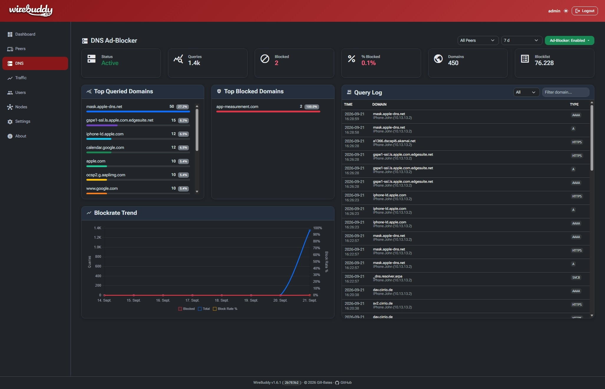
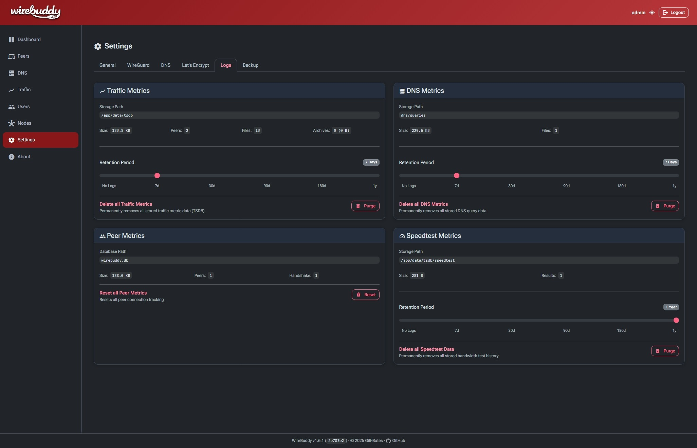

<p align="center">
  
<br>
Use WireGuard with ease!
</p>

<p align="center">
  <a href="https://github.com/Gill-Bates/wirebuddy/releases"></a>
  <a href="https://hub.docker.com/r/giiibates/wirebuddy"></a>
  <a href="https://hub.docker.com/r/giiibates/wirebuddy"></a>
  <a href="https://github.com/Gill-Bates/wirebuddy/blob/main/LICENSE"></a>
</p>

<p align="center">
  <a href="https://gill-bates.github.io/wirebuddy/getting-started/quick-start/"></a>
  <a href="https://gill-bates.github.io/wirebuddy/"></a>
  <a href="https://gill-bates.github.io/wirebuddy/changelog/"></a>
</p>

---

A complete self-hosted VPN solution with web-based management, integrated Unbound DNS resolver, ad-blocking, real-time traffic analytics, and GeoIP visualization.

<p align="center">
  <br>
  <em>Dashboard — network status, peer locations, and speedtest history at a glance.</em>
</p>

<details>
  <summary align="center"><b>More screenshots</b></summary>
  <br>
  <p align="center">
    <br>
    <em>Login — Auto/Light/Dark theme toggle, no account enumeration on failed attempts.</em>
  </p>
  <p align="center">
    <br>
    <em>Traffic — per-peer RX/TX charts with destination breakdown by country and ASN.</em>
  </p>
  <p align="center">
    <br>
    <em>DNS ad-blocking — live query log, top blocked domains, and block-rate trend.</em>
  </p>
  <p align="center">
    <br>
    <em>WireGuard Settings — global tunnel defaults, interface management, and traffic analysis.</em>
  </p>
  <p align="center">
    <br>
    <em>Logs — per-dataset retention and storage stats, with one-click purge.</em>
  </p>
</details>

## Features

| Category | Highlights |
|---|---|
| **WireGuard VPN** | Multi-interface management, automatic keypair generation, routing presets, client isolation, QR codes for mobile setup |
| **Multi-Node** | Distributed VPN clusters, automatic peer synchronization, metrics aggregation, and token-based enrollment |
| **DNS Ad-Blocking** | Integrated Unbound resolver with blocklists, DNS-over-TLS, real-time query log, DNSSEC, client-scoped rules |
| **Monitoring** | Built-in time-series database, per-peer traffic charts, traffic analysis by country & ASN |
| **GeoIP** | MaxMind GeoLite2 integration, interactive heatmap, country flags & ASN badges |
| **HTTPS & Certificates** | Built-in HTTPS with self-signed or Let's Encrypt certificates, HTTP-01 validation, and certificate management |
| **User Management** | Multi-user roles, Passkeys (WebAuthn) & two-factor authentication (2FA, TOTP), login tracking |
| **Web UI** | Customizable drag-and-drop dashboard, responsive Bootstrap 5, dark/light/auto theme, Material Icons |

---

## Getting Started

```bash
docker pull giiibates/wirebuddy:latest
```

WireBuddy expects Linux with `network_mode: host` and WireGuard support in the
host kernel. Set `WIREBUDDY_SECRET_KEY` (required) and
open `http://<your-server-ip>:8000`. The temporary `admin` password is printed
once to the container log (`docker logs wirebuddy`).

The default setup serves the GUI over HTTP. To use WireBuddy's built-in HTTPS,
enable **Settings → General → Serve GUI over HTTPS**, then restart the
container. It uses a self-signed certificate until you obtain a Let's Encrypt
certificate in **Settings → Let's Encrypt**, and falls back to it whenever that
certificate is expired, not yet valid, or does not cover the host name.

For the Compose file, `docker run` command, environment variables, and security
setup, see the **[Documentation](https://gill-bates.github.io/wirebuddy/getting-started/docker/)**.

---

## License

Released under the [MIT License](https://github.com/Gill-Bates/wirebuddy/blob/main/LICENSE).

Maintained by [Gill-Bates](https://github.com/Gill-Bates).

<p align="center">
  <a href="https://www.buymeacoffee.com/tnsteinerx">
    
  </a>
</p>
