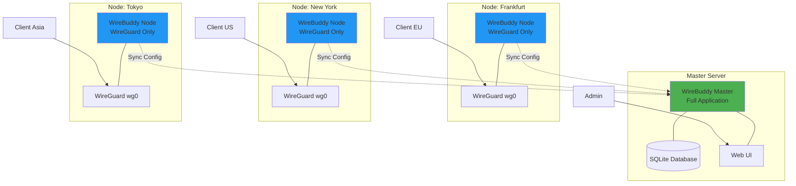
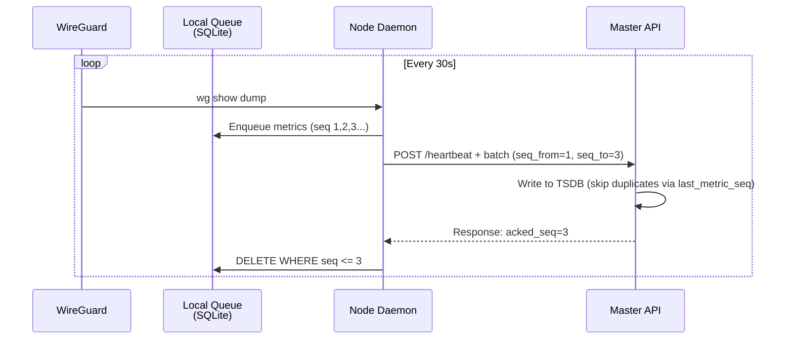

# Multi-Node Deployment

Deploy WireBuddy across multiple geographic locations with the Master-Node architecture.

## Overview

The Master-Node architecture allows you to:

- **Deploy WireGuard servers in multiple countries/regions** while managing them from a single interface
- **Assign peers to specific nodes** based on their geographic location
- **Scale horizontally** by adding more nodes without touching the master
- **Centralize management** — all configuration happens on the master server



## Architecture

### Master Server

The **master** runs the full WireBuddy application including:

- ✅ Web UI and API
- ✅ SQLite database with all configuration
- ✅ User management and authentication
- ✅ Optional: WireGuard interfaces (master can also serve VPN traffic)
- ✅ Optional: DNS resolver (Unbound)
- ✅ Optional: Metrics collection

### Node Server

A **node** runs only what's essential for VPN connectivity:

- ✅ WireGuard kernel module and interfaces
- ✅ Lightweight sync daemon (no web server)
- ✅ Per-node API secret (Bearer) for authentication to the master; a
  self-signed certificate whose fingerprint is checked only behind a trusted
  mTLS proxy
- ❌ No database
- ❌ No web UI
- ❌ No DNS resolver
- ❌ No local metrics storage — peer counters are queued and forwarded to the
  master, see [Metrics & Reliable Delivery](#metrics-reliable-delivery)

## Security Model

### Enrollment

1. Admin creates a node in the master UI → receives a **signed enrollment token**
2. Token is provided to the node via `WIREBUDDY_ENROLLMENT_TOKEN` environment variable
3. Node generates a self-signed EC P-256 certificate on first boot
4. Node enrolls with master using the token and sends its certificate fingerprint
5. Token is single-use: it expires after successful enrollment, or 24 hours after it was issued

Token formats:

| Version | Format | Signed with | Verified by the node with |
|---------|--------|-------------|---------------------------|
| v2 (default) | `wb2.<payload>.<Ed25519 signature>` | Ed25519 private key, kept on the master | Public key `wbpk2:...` |
| v1 (deprecated) | `base64url(JSON_PAYLOAD.HMAC_SHA256_SIGNATURE)` | `WIREBUDDY_SECRET_KEY` | The same secret |

The master creates the v2 signing key on first use. It is stored encrypted with
`WIREBUDDY_SECRET_KEY` in the settings table and is included in backups. The
node pins the public key (`wbpk2:...`) through `WIREBUDDY_ENROLLMENT_VERIFY_KEY`
and never takes it from the token. A node that pins a `wbpk2:` key refuses v1
tokens.

Read the public key from the create or regenerate response, or with
`GET /api/nodes/enrollment-key`. The Nodes page does not show it yet.
`POST /api/nodes/enrollment-key/rotate` replaces the signing key: unused v2
tokens then fail and must be regenerated, and nodes that are not yet enrolled
need the new public key.

A v1 token needs the master's `WIREBUDDY_SECRET_KEY` on the node, which would
also let that node forge tokens. Migrate to v2, see
[Migration from HMAC enrollment tokens](#migration-from-hmac-enrollment-tokens).

!!! warning "Enrollment transport"
    Enrollment is the one time the master hands the node its long-lived
    `session_secret`. When the master has **Serve GUI over HTTPS** enabled or
    `WIREBUDDY_REQUIRE_HTTPS_AUTH` set, enrollment over plain HTTP is rejected
    with `400` (loopback excepted) and the node must reach the master over
    `https://`. Otherwise the request is still accepted for plain-HTTP LAN
    setups, but the master logs an error, because the secret is then transmitted
    in clear text.

    If the master uses the self-signed fallback certificate, the node must trust
    it — see [Node cannot enroll over HTTPS](../troubleshooting.md#node-cannot-enroll-over-https).

### Sync Authentication

Enrollment uses a signed enrollment token. The node sends its self-signed
certificate, and the master stores its fingerprint. After enrollment, sync
requests authenticate with the Bearer API secret:

- Node → Master: `Authorization: Bearer {api_secret}`; the master compares the
  secret's hash.
- Under the same conditions as enrollment (**Serve GUI over HTTPS** or
  `WIREBUDDY_REQUIRE_HTTPS_AUTH`), a sync request over plain HTTP is rejected
  with `400`; loopback is exempt.
- The certificate fingerprint is checked only as an additional step, and only
  when a reverse proxy listed in `WIREBUDDY_MTLS_PROXIES` (a CIDR list, empty by
  default and independent of `WIREBUDDY_TRUSTED_PROXIES`) terminates mTLS and
  passes it in `X-Client-Cert-Fingerprint`. Without such a proxy the header is
  ignored and the Bearer secret is the only credential. Every proxy in front
  must strip a client-supplied `X-Client-Cert-Fingerprint`, and only the
  mTLS-terminating proxy may set it. List specific proxy IPs: a broad range lets
  any host in it forge a fingerprint. Invalid entries are ignored, and a change
  needs a restart.
- No external PKI is required.

### Migration from HMAC enrollment tokens

Enrolled nodes authenticate with their session secret and certificate, not with
the token, so they keep working throughout. Defaults accept both versions;
`WIREBUDDY_ENROLLMENT_ACCEPT_V1` and `WIREBUDDY_ENROLLMENT_ALLOW_V1` are planned
to default to `0` in a later release.

1. Upgrade the master. It creates the Ed25519 key on first use, issues v2 tokens
   and still accepts v1. Pending v1 tokens (up to 24 hours old) keep working.
2. Upgrade node images at any time. Set `WIREBUDDY_ENROLLMENT_TOKEN_VERSION=1` on
   the master only while an old node image must still be enrolled.
3. For every new enrollment or token regeneration, set the token in
   `WIREBUDDY_ENROLLMENT_TOKEN` and the `wbpk2:` key in
   `WIREBUDDY_ENROLLMENT_VERIFY_KEY`.
4. On enrolled nodes, remove the legacy secret from `.env`. A restart is not
   required.
5. Watch the master log for `Accepted deprecated v1` and the
   `enrollment_v1_last_used_at` setting. When no v1 use remains, set
   `WIREBUDDY_ENROLLMENT_ACCEPT_V1=0` on the master and restart it, then set
   `WIREBUDDY_ENROLLMENT_ALLOW_V1=0` on the nodes.
6. Rotate `WIREBUDDY_SECRET_KEY` if node hosts are less trusted than the master:
   a host that held it keeps that knowledge, and removing it from `.env` does not
   undo the exposure. Rotation tooling has not been verified.
7. `POST /api/nodes/enrollment-key/rotate` replaces the signing key when needed.

### Network Security

!!! warning "Firewall Configuration"
    - Master API endpoint (`/api/nodes/*`) should be **firewall-protected**
    - Only allow node IPs to access the sync endpoints
    - Use a VPN tunnel between master and nodes for additional security

## Deployment Guide

### 1. Deploy Master Server

A master is just a standard WireBuddy installation — `SERVER_MODE` defaults to
`master`, so nothing extra is required. Deploy it with the supplied
`docker/docker-compose.yml` as described in the
[Installation Guide](../getting-started/installation.md#docker-compose-recommended).

Do not hand-write a reduced Compose service for the master: it needs the full
capability set and `no-new-privileges` that the shipped file
already declares. The node service below is the one that differs.

### 2. Create Node in UI

1. Navigate to **Nodes** in the sidebar (admin-only)
2. Click **Add Node**
3. Fill out the form:
   - **Name**: Display name (e.g., "Frankfurt", "NYC-01") — must be unique
   - **FQDN/IP**: Public address where clients will connect (e.g., `de.vpn.example.com`) — must be unique
   - **WireGuard Port**: Node's WireGuard listen port (default: `51820`)

!!! warning "Uniqueness Constraints"
    Both **Name** and **FQDN** must be unique across all nodes. Duplicate values will be rejected with a 409 Conflict error.

4. Click **Create** → enrollment token is displayed

!!! tip "Token Display"
    The token is shown **only once**. Copy it immediately and store securely.

### 3. Deploy Node Server

#### Host Prerequisites

Before deploying the node container, the host machine must have **IP forwarding enabled**:

```bash
# Enable immediately
sudo sysctl -w net.ipv4.ip_forward=1
sudo sysctl -w net.ipv6.conf.all.forwarding=1

# Persist across reboots
echo "net.ipv4.ip_forward=1" | sudo tee -a /etc/sysctl.d/99-wireguard.conf
echo "net.ipv6.conf.all.forwarding=1" | sudo tee -a /etc/sysctl.d/99-wireguard.conf
sudo sysctl --system
```

!!! warning "Required for VPN Traffic"
    Without IP forwarding, peers can connect but cannot route internet traffic through the node.

#### Docker Compose

Use the repository's node Compose file, `docker/docker-compose.node.yml`:

```yaml
services:
  wirebuddy-node:
    image: giiibates/wirebuddy:latest
    container_name: wirebuddy-node
    restart: always
    stop_grace_period: 20s
    network_mode: host
    init: true
    pids_limit: 256
    cap_drop:
      - ALL
    cap_add:
      - NET_ADMIN   # node mode runs no resolver, so NET_ADMIN alone is enough
    environment:
      SERVER_MODE: node
      WIREBUDDY_ENROLLMENT_TOKEN: "${WIREBUDDY_ENROLLMENT_TOKEN:?Set WIREBUDDY_ENROLLMENT_TOKEN in .env}"
      WIREBUDDY_ENROLLMENT_VERIFY_KEY: "${WIREBUDDY_ENROLLMENT_VERIFY_KEY:-}"
      WIREBUDDY_DATA_DIR: /app/data
      LOG_LEVEL: "${LOG_LEVEL:-INFO}"
    logging:
      driver: json-file
      options:
        max-size: "10m"
        max-file: "3"
    security_opt:
      - no-new-privileges:true
    volumes:
      - ./data:/app/data
    # Node mode runs the enrollment daemon, not uvicorn, so the healthcheck
    # probes for the daemon process instead of an HTTP endpoint.
    healthcheck:
      test: ["CMD", "pgrep", "-f", "app.node.daemon"]
      interval: 30s
      timeout: 5s
      retries: 3
      start_period: 15s
```

**Environment Variables:**

| Variable | Required | Description |
|----------|----------|-------------|
| `SERVER_MODE` | Yes | Must be `node` |
| `WIREBUDDY_ENROLLMENT_TOKEN` | Yes | Token from master UI (contains master URL) |
| `WIREBUDDY_ENROLLMENT_VERIFY_KEY` | First enrollment | The master's public key `wbpk2:...`. Not needed once the node is enrolled. A value without the prefix is the deprecated v1 secret. Without a key the daemon aborts the first bootstrap |
| `WIREBUDDY_DATA_DIR` | No | Data directory inside the container (default: `/app/data`) |
| `LOG_LEVEL` | No | Logging verbosity (default: `INFO`) |

!!! info "Master URL in Token"
    The master URL is embedded in the enrollment token — no separate `WIREBUDDY_MASTER_URL` variable needed.

Start the node:

```bash
docker compose --env-file .env -f docker/docker-compose.node.yml up -d
```

### 4. Verify Enrollment

Check node logs:

```bash
docker logs wirebuddy-node
```

Expected output:

```
2026-01-01 12:00:00 UTC | INFO     | wirebuddy | WireBuddy Node Daemon starting...
2026-01-01 12:00:01 UTC | INFO     | wirebuddy | Enrolling with master at https://vpn.example.com...
2026-01-01 12:00:01 UTC | INFO     | wirebuddy | Received session secret from master (enrollment token is now invalidated)
2026-01-01 12:00:02 UTC | INFO     | wirebuddy | Enrollment successful, starting sync loop
2026-01-01 12:00:02 UTC | INFO     | wirebuddy | SSE event stream connected — config changes will be pushed instantly
```

In the master UI, the node status should change from `pending` → `online`.

## Usage

### Assigning Peers to Nodes

When creating or editing a peer:

1. In the **Add Peer** or **Edit Peer** modal
2. Select the target node from the **Node** dropdown
3. Leave empty for local peers (master's WireGuard interface)

The peer's configuration will include the node's FQDN and port as the `Endpoint`.

### QR Code Generation

QR codes automatically reflect the node assignment:

- **Local peer**: Master's FQDN + master's public key
- **Remote peer**: Node's FQDN + node interface's public key

#### Node Badge

For peers assigned to a remote node, the QR code image includes a **coloured badge** showing the node name (e.g., "Frankfurt", "NYC-01"). This makes it easy to identify which VPN exit a configuration targets — especially useful when printing QR codes or managing many devices.

!!! info "Local Peers"
    Peers assigned to the master (local) do not show a node badge.

### Node Management

**View Node Status:**

- Navigate to **Nodes** page
- Each node shows:
  - Status badge (online/offline/pending/error)
  - Last seen timestamp
  - WireGuard port
  - Number of assigned peers

**Edit Node:**

- Update name, FQDN, or WireGuard port
- Changes propagate to all peers on that node on next sync

**Regenerate Enrollment Token:**

- If a node needs to re-enroll (e.g., lost certificate)
- Old token is invalidated
- Deploy new token to node

**Delete Node:**

- Revokes the node's tunnel peer from the running WireGuard interface **before**
  the database row is removed
- Removes node from database
- All peers on that node are **unassigned** (node_id set to NULL)
- Node will fail authentication on next sync attempt

!!! note "Revocation is enforced"
    If the tunnel peer cannot be removed while its interface is up, the delete
    is refused with `503` and the node is kept. This prevents a deleted node
    from continuing to forward traffic with a key that is still loaded in the
    kernel. When the interface is not running there is no live access to revoke,
    so the delete proceeds.

!!! danger "Peer Handling"
    Deleting a node does **not** delete its peers. Update peer assignments before deletion.

## Sync Behavior

### Heartbeat

Nodes send a heartbeat every **30 seconds** with:

- Current timestamp
- WireGuard interface status

Master updates `last_seen` timestamp and sets `status=online`.

### Config Pull

Nodes fetch configuration every **30 seconds** and compare `config_version`.
The master also pushes config changes over an SSE event stream; while that
stream is disconnected, the node polls every **5 seconds**. Both intervals are
set by `WIREBUDDY_NODE_SYNC_INTERVAL` and `WIREBUDDY_NODE_SYNC_INTERVAL_FAST`
(see [Environment Variables](../configuration/environment.md)).

- If version changed → apply config diff
- Only changed interfaces are updated (no service disruption)
- Only changed peers within an interface are updated

### Stale Detection

Master's scheduled task runs every **60 seconds** and marks nodes as `offline` if:

- `last_seen` is older than **90 seconds**

### Error Handling

Nodes use **exponential backoff** on sync failures:

- Initial retry: 2 seconds, doubling per failure, with ±20 % jitter
- Max backoff: 60 seconds
- Backoff resets on successful sync

## Configuration Details

### WireGuard Interfaces on Nodes

Nodes create WireGuard interfaces based on master configuration:

- Interface name, IP address, listen port from master
- Keypairs are **node-specific** and stored in `node_interfaces` table
- Private keys are Fernet-encrypted in master database

### DNS Resolution & Tunneling

Nodes do **not** run their own DNS resolver. Instead, a **WireGuard tunnel** is automatically created between each node and the master during enrollment:

1. Master allocates a tunnel IP for the node on the first WireGuard interface
2. Node configures the master as a WireGuard peer with `PersistentKeepalive = 25`
3. Node peers receive the **master's DNS server IP** (Unbound) in their client config
4. DNS queries from node peers are routed through the WireGuard tunnel back to the master

This ensures:

- **Centralised ad-blocking** — all peers benefit from the master's blocklists, regardless of which node they connect to
- **Centralised DNS logging** — all queries appear in the master's DNS log
- **No DNS software required on nodes** — keeps node footprint minimal

!!! note "Internet Traffic"
    Only DNS traffic is tunnelled to the master. Regular internet traffic exits directly through the node's outbound connection.

### Metrics & Reliable Delivery

Nodes collect WireGuard peer statistics (rx/tx bytes, handshakes) and deliver them to the master using a **reliable queue** with **at-least-once delivery** guarantees.

#### Architecture



#### Delivery Guarantees

| Guarantee | How |
|-----------|-----|
| **At-least-once** | Metrics remain in local queue until master ACKs |
| **Idempotency** | Master tracks `last_metric_seq` per node, skips duplicates |
| **Crash-safe** | SQLite WAL mode survives node/master restarts |
| **Offline-tolerant** | Queue grows up to 10,000 metrics during disconnection |

#### Queue Configuration

| Setting | Value | Description |
|---------|-------|-------------|
| `MAX_QUEUE_SIZE` | 10,000 | Oldest metrics dropped on overflow |
| `MAX_BATCH_SIZE` | 500 | Metrics per heartbeat |
| Database | `data/metrics_queue.db` | SQLite with WAL mode |

#### Metric Types

- **`peer_traffic`**: `rx_bytes`, `tx_bytes` per peer (cumulative counters)
- **`peer_handshake`**: `latest_handshake`, `endpoint` per peer

!!! info "TSDB Integration"
    Metrics from nodes are written to the master's TSDB under the peer's public key, appearing alongside local peer metrics in the dashboard traffic charts.
    The master accepts metrics only for peers assigned to the reporting node or
    allowed on all nodes (roaming); data for any other peer is ignored.

## Troubleshooting

### Peers Connect But Cannot Browse Internet

**Symptom:** VPN tunnel establishes (handshake OK) but no internet access through node.

**Check IP forwarding:**

```bash
sysctl net.ipv4.ip_forward
# Should show: net.ipv4.ip_forward = 1
```

If not enabled, see [Host Prerequisites](#host-prerequisites) above.

**Check iptables FORWARD chain:**

```bash
docker exec wirebuddy-node iptables -L FORWARD -n -v --line-numbers
```

The WireGuard rules should be at positions 1 and 2:

```
num   pkts bytes target     prot opt in     out     source               destination
1        0     0 ACCEPT     all  --  *      wg0     0.0.0.0/0            0.0.0.0/0
2      193 12700 ACCEPT     all  --  wg0    *       0.0.0.0/0            0.0.0.0/0
```

!!! tip "UFW Users"
    WireBuddy uses `-I FORWARD 1` to insert rules before UFW. No manual UFW configuration needed.

### Node Shows "Offline" in UI

**Check node logs:**

```bash
docker logs wirebuddy-node --tail 50
```

**Common issues:**

- **Network connectivity**: Master URL not reachable from node
- **Firewall**: Master API port blocked
- **Certificate mismatch**: delete `node.crt` and `node.key` from the node's data
  directory (`./data/` on the host with the supplied Compose file), then restart
  the node — it regenerates the pair and must be re-enrolled with a fresh token

### Node Fails Enrollment

**Error: "Token signature verification failed" or "Token has expired"**

- Token is older than 24 hours
- Token signature is invalid (`WIREBUDDY_ENROLLMENT_VERIFY_KEY` does not match the master's `wbpk2:` key, or, for a v1 token, its `WIREBUDDY_SECRET_KEY`)
- Regenerate token in master UI

**Error: "v2 token requires a wbpk2: key"**

- The node has the legacy secret or no key. Set `WIREBUDDY_ENROLLMENT_VERIFY_KEY` to the master's `wbpk2:` key.

**Error: "legacy v1 token refused: v2 key pinned"**

- The node pins a `wbpk2:` key and the token is v1. Regenerate the token on a master that issues v2.

**Error: "Legacy enrollment tokens are no longer accepted"**

- The master runs with `WIREBUDDY_ENROLLMENT_ACCEPT_V1=0`. Regenerate the token as v2.

**Error: "Token was signed by a different master key"**

- The signing key was rotated after the token was issued. Regenerate the token and use the current `wbpk2:` key.

**Error: "Enrollment signing key is unreadable; rotate it"**

- A restore ran under a different `WIREBUDDY_SECRET_KEY`. Call `POST /api/nodes/enrollment-key/rotate`; enrolled nodes are not affected.

**Error: "Node is already enrolled" or "API secret mismatch"**

- Token was already used
- Regenerate token in master UI

**Error: "Enrollment token invalid or node deleted"**

- Node was deleted from master after enrollment
- Recreate node and re-deploy with new token

### Peer Config Shows Wrong Endpoint

**Symptoms:**

- Peer QR code or config shows master's FQDN instead of node's

**Solution:**

- Check peer's `node_id` assignment in UI
- Verify node's FQDN is correct in Nodes page
- Re-download peer config after fixing

### DNS Not Working Through Node

**Symptom:** Internet works with `9.9.9.9` but not with the default DNS (10.13.13.1).

DNS queries are routed through the WireGuard tunnel to the master's Unbound resolver. Check the route:

```bash
docker exec wirebuddy-node ip route get 10.13.13.1
# Should show: 10.13.13.1 dev wg0 ...
```

If it shows `via eth0`, the route is missing. This indicates a sync issue — restart the node:

```bash
docker restart wirebuddy-node
```

### Config Changes Not Propagating

**Check:**

1. Node status is `online` (not `offline` or `error`)
2. Node logs show applied config changes: `Applied new config (version=...)`
3. Master's `config_version` incremented after peer changes (check logs)

**Force sync:**

- Restart node: `docker restart wirebuddy-node`
- Node will fetch latest config on startup

### Node Metrics Not Appearing in Dashboard

**Symptom:** Remote peers show "Last seen" but no traffic data in charts.

**Check node logs for ACK:**

```bash
docker logs wirebuddy-node --tail 100 | grep -i ack
```

Expected, with `LOG_LEVEL=DEBUG`: `ACK received: deleted X metrics (up to seq Y)`

**If no ACK:**

- Master endpoint may be timing out
- Check disk space on node (`data/metrics_queue.db` grows during disconnection)

**Check queue stats:**

```bash
docker exec wirebuddy-node python -c "
from pathlib import Path
from app.node.metrics_queue import init_queue, get_queue_stats, close_queue
conn = init_queue(Path('/app/data'))
print(get_queue_stats(conn))
close_queue(conn)
"
```

**Force flush:**

- Restart node to trigger immediate heartbeat + ACK
- Check master TSDB for peer data: `ls data/tsdb/peers/`

## API Reference

### Admin Endpoints (Master)

```http
POST   /api/nodes
GET    /api/nodes
GET    /api/nodes/{node_id}
PATCH  /api/nodes/{node_id}
DELETE /api/nodes/{node_id}
POST   /api/nodes/{node_id}/token
GET    /api/nodes/enrollment-key
POST   /api/nodes/enrollment-key/rotate
POST   /api/nodes/{node_id}/restart
POST   /api/nodes/{node_id}/speedtest
GET    /api/nodes/{node_id}/speedtest/stream
```

### Sync Endpoints (Node → Master)

```http
POST /api/nodes/enroll
POST /api/nodes/heartbeat
GET  /api/nodes/config
GET  /api/nodes/events
POST /api/nodes/commands/{command_id}/ack
POST /api/nodes/speedtest
POST /api/nodes/speedtest/progress
```

See [API Reference](../api/endpoints.md) for full documentation.

## Performance Considerations

### Master Server

- No performance impact from nodes (sync traffic is minimal)
- API rate limiting applies to node sync endpoints (fixed limits, for example 600 requests per minute for heartbeat and config polling)

### Scaling Limits

- The binding constraint is the master: its SQLite database and single-process
  control plane serialize configuration writes and metric ingestion. Adding nodes
  scales VPN capacity, not control-plane capacity.
- There is no multi-master mode. The master is a single point of failure for
  configuration changes; nodes keep forwarding traffic on their last known config
  while it is down.

## FAQ

??? question "Can a node also be a master?"
    No. A server runs either as `master` or `node`, not both. However, a master can have local WireGuard interfaces serving peers directly.

??? question "Can peers connect to multiple nodes?"
    Yes, with **Allow on all Nodes** in the peer form: the peer can then connect to any node with the same credentials. Without it, a peer belongs to exactly one node or the master.

??? question "What happens if the master goes down?"
    Nodes continue serving VPN traffic with their last known config. Re-sync resumes when master is back online. No auth/config changes are possible while master is down.

??? question "Can I use Let's Encrypt on nodes?"
    Not needed. Nodes use self-signed certificates for master authentication only. Client-facing certificates (if any) should be provisioned separately.

??? question "How do I migrate a peer from one node to another?"
    Edit the peer in the UI and change the **Node** dropdown. The peer's config regenerates with the new endpoint.

??? question "Can I run a node without Docker?"
    Yes. Set `SERVER_MODE=node` and the enrollment variables in `.env`, load them into the environment, then run `python -m app.server`. Requires Python 3.14+ (see [Installation](../getting-started/installation.md)) and WireGuard installed.
